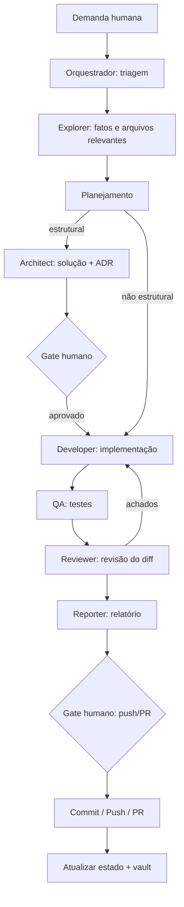

# START — Triagem de demanda (Orquestrador)

Toda demanda humana começa aqui. O Orquestrador escolhe o **fluxo proporcional** à mudança.

## 1. Classifique

| Tipo | Exemplos | Fluxo |
|---|---|---|
| **Pergunta factual** | "onde fica X?", "existe teste para Y?" | Explorer → resposta |
| **Trivial** | typo, texto da UI, ajuste de doc | Implementação → commit |
| **Pequena** | bug localizado, ajuste em 1 módulo | Exploração → Implementação → Testes → Revisão → Commit |
| **Média** | feature dentro de uma fase do roadmap | Planejamento → Implementação → Testes → Revisão → Report → Commit/PR |
| **Grande / estrutural** | novo módulo, mudança de contrato, nova integração | Planejamento → **Arquitetura (ADR + gate humano)** → Implementação → Testes → Revisão → Report → Commit/PR |
| **Fora do escopo do MVP** | qualquer coisa não listada em `MVP_SCOPE.md` | Registrar em `POST_MVP_BACKLOG.md` e **perguntar** antes de fazer |

## 2. Verifique antes de agir

- A demanda pertence à **fase atual** (`vault/11_ROADMAP/DEVELOPMENT_PLAN.md`)? Se não, sinalize.
- Toca alguma **regra de negócio R1–R16** ou **invariante**? Se alterar → gate humano.
- Exige um **gate humano**? (`vault/05_WORKFLOWS/HUMAN_GATES.md`)

## 3. Fluxo completo de referência

## 4. Etapas

| Etapa | Arquivo |
|---|---|
| Intake (novas ideias grandes) | `INTAKE.md` |
| Planejamento | `PLANEJAMENTO.md` |
| Implementação | `IMPLEMENTACAO.md` |
| Testes | `TESTES.md` |
| Revisão | `REVISAO.md` |
| Homologação / release local | `DEPLOY.md` |
| Commit / push / PR | `COMMIT_PUSH.md` |

## 5. Encerramento de toda demanda

- [ ] `vault/00_HOME/PROJECT_STATUS.md` atualizado se o estado mudou
- [ ] Checklist da fase em `DEVELOPMENT_PLAN.md` **e** `docs/development-plan.html` atualizados se algum item foi concluído
- [ ] Decisão nova? → `vault/10_DECISIONS/DECISION_LOG.md` (ou ADR)
- [ ] Sessão terminando? → skill `handoff`
