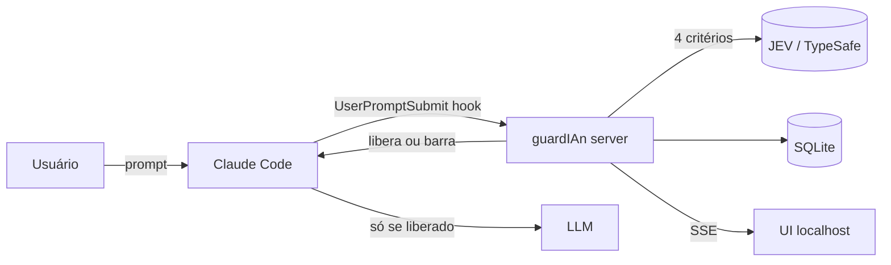

# 🛡️ guardIAn — START HERE

> **Fonte única da verdade** do projeto. Se não está aqui (ou num ADR), não é decisão.

## O que é
O guardIAn é um **portão de qualidade para prompts**: intercepta o prompt **antes** de ele chegar à LLM de código (Claude Code primeiro, Codex depois), avalia com o **JEV** (TypeSafe) em 4 critérios e só deixa passar o que tem chance de gerar o resultado esperado — reduzindo tokens desperdiçados, custo e retrabalho.

## Situação atual
| | |
|---|---|
| **Versão** | `v0.5.0` |
| **Fase** | ✅ Fases 6 e 7 concluídas · ⏭️ **Fase 8 — QA e Homologação** |
| **Última decisão** | Comandos `/guardian-*` executados pelo próprio hook (D42) |
| **Próxima ação** | QA paralelo + roteiro de homologação no Claude Code real |

Detalhes: [[PROJECT_STATUS]].

## Mapa do vault
| Preciso entender… | Vá para |
|---|---|
| Visão e escopo do MVP | [[PRODUCT_VISION]] · [[MVP_SCOPE]] |
| Regras que não podem ser violadas | [[BUSINESS_RULES]] · [[BUSINESS_INVARIANTS]] · [[STATE_MACHINES]] |
| Como o JEV pontua | [[JEV_RUBRIC]] |
| Como o sistema funciona | [[SYSTEM_OVERVIEW]] · [[ARCHITECTURE]] · [[MODULE_MAP]] |
| Dados e APIs | [[DATA_MODEL]] · [[API_CONTRACTS]] · [[INTEGRATIONS]] |
| Decisões | [[DECISION_LOG]] · [[03_ARCHITECTURE/ADR/README\|ADRs]] |
| Roadmap e fases | [[DEVELOPMENT_PLAN]] · [[POST_MVP_BACKLOG]] · [[RISKS]] |
| Segurança | [[SECURITY]] |
| Testes e homologação | [[TEST_STRATEGY]] · [[HOMOLOGATION_SCRIPT]] |
| Git e convenções | [[GITFLOW]] · [[CONVENTIONS]] |
| Gates humanos | [[HUMAN_GATES]] |
| Como usar IA no projeto | [[AI_DEVELOPMENT_MANUAL]] · [[MODEL_STRATEGY]] |

## Stack (resumo)
Node 22 LTS · TypeScript · pnpm workspaces · Fastify · SQLite + Drizzle · React + Vite + Tailwind · SSE · SDK JS TypeSafe · Vitest · ESLint/Prettier · lefthook · GitHub Actions.

## Arquitetura (resumo)
Monólito modular local (`127.0.0.1:7070`) com duas portas: `Avaliador` (JEV real / fake) e `AdaptadorCLI` (Claude Code agora). Distribuído como **plugin do Claude Code** (`/guardian-active`, `/guardian-inactive`).

