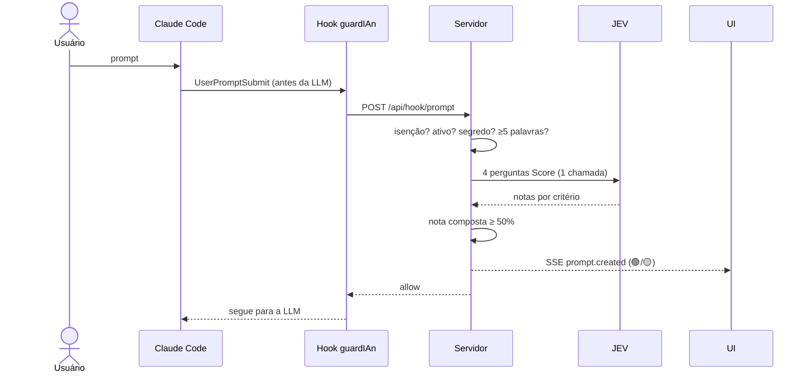
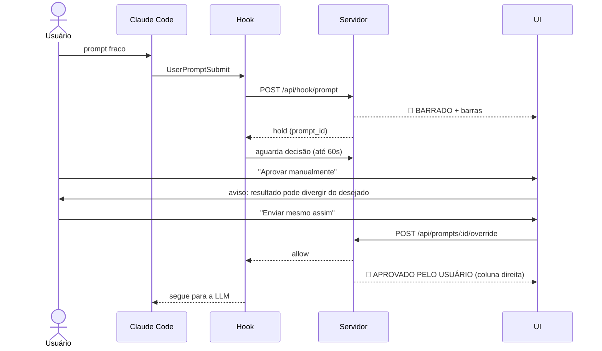

# Jornadas do usuário

## J1 — Ativar o guardIAn num projeto
1. Usuário sobe o servidor (`pnpm start`) e abre `http://127.0.0.1:7070`.
2. No Claude Code, dentro do projeto, digita `/guardian-active`.
3. O projeto aparece como **aba** na UI.

## J2 — Prompt aprovado (caminho feliz)

## J3 — Prompt barrado e override

Se ninguém clicar em 60s → prompt descartado, nada é enviado. "Cancelar" → descartado imediatamente.

## J4 — Prompt com segredo
Usuário cola uma chave no prompt → 🔴 **BARRADO — SEGREDO DETECTADO** imediatamente, sem JEV, sem override (D38). Histórico mostra o prompt com `[SEGREDO:<tipo>]`.

## J5 — Playground
Usuário abre a aba Playground, digita um prompt, clica "Avaliar" → vê marcador e barras. **Nada é enviado à LLM.** (Consome créditos do JEV.)

## J6 — JEV fora do ar
Prompt passa direto com marcador ⚪ **JEV INDISPONÍVEL**; banner de aviso no topo da UI.
