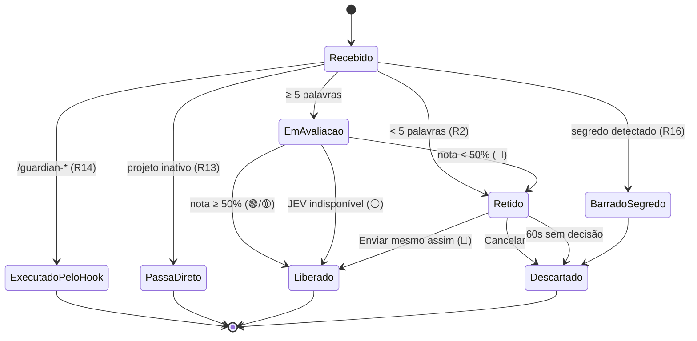
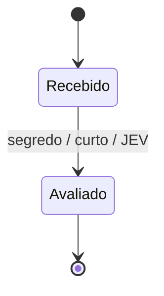
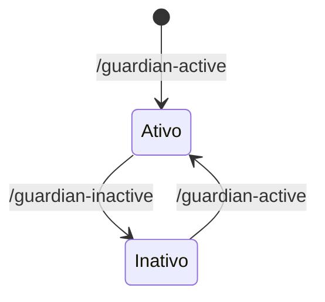
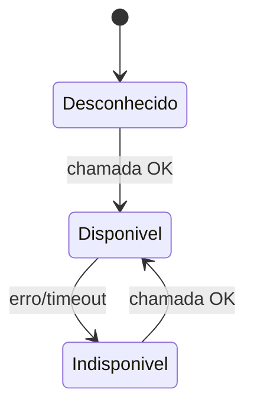

# Máquinas de estado

## Ciclo de vida do prompt (CLI)

`ExecutadoPeloHook` e `PassaDireto` **não** são persistidos como prompts. O comando altera apenas o estado do projeto.

## Prompt do playground

## Projeto

## Saúde do JEV (UI)

