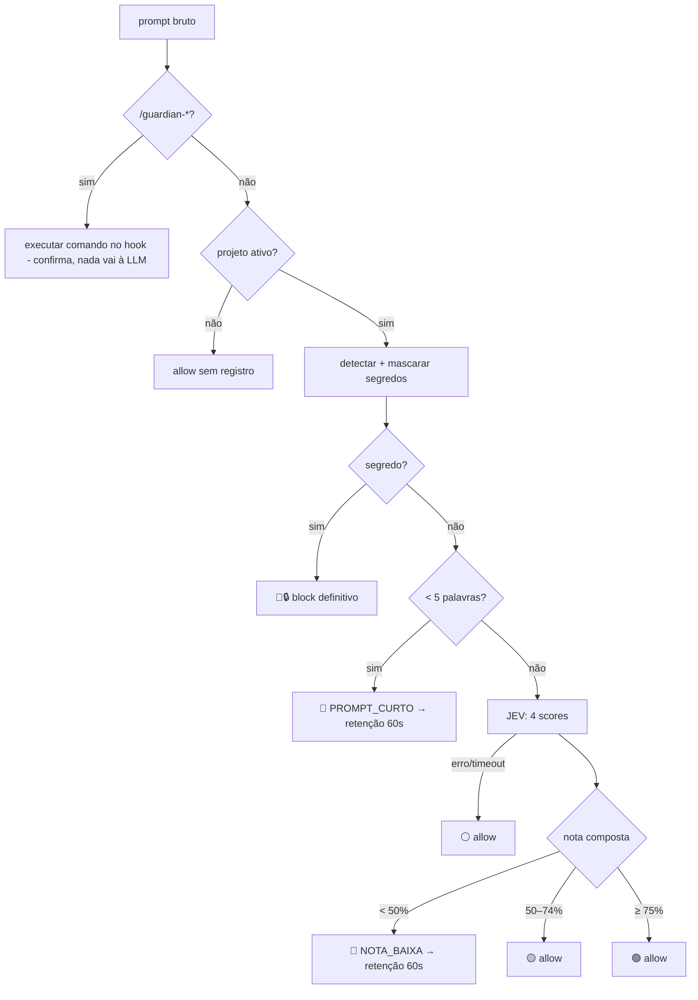

# Arquitetura

## Estilo
**Monólito modular em camadas**, com **duas portas** apenas onde há troca real de implementação ([[ADR-0003-monolito-modular-com-portas]]):

| Porta | Implementações | Por quê |
|---|---|---|
| `Avaliador` | `AvaliadorJev` (SDK TypeSafe) · `AvaliadorFake` (testes, CI) | Testar sem gastar créditos; tratar indisponibilidade |
| `AdaptadorCLI` | Claude Code (MVP) · Codex (futuro) | Formato de entrada/saída do hook difere por CLI |

Sem DDD pesado, CQRS, mensageria, filas ou microserviços.

## Camadas do servidor
```text
http/          rotas Fastify (hook, prompts, projetos, playground, health, SSE)
   ↓
aplicacao/     casos de uso: avaliarPromptDoCli, avaliarNoPlayground, override, cancelar, ativar/desativar projeto
   ↓
dominio/       regras puras (sem I/O): isenção, contagem de palavras, segredos+mascaramento, composição de nota, faixas
   ↓
infra/         AvaliadorJev, repositórios Drizzle/SQLite, publicador SSE, relógio
```
O **domínio** é puro e totalmente testável. Regras e limiares vêm de `packages/shared`.

## Pipeline de avaliação (I4)


## Retenção de 60s (proposta — validar no spike, [[ADR-0005-interceptacao-via-plugin-hook]])
1. O hook chama `POST /api/hook/prompt`. Se a resposta for `hold`, o hook faz **long-poll** em `GET /api/hook/prompt/:id/wait` (até 60s).
2. A UI faz override/cancelamento; o servidor resolve a espera.
3. O hook devolve ao Claude Code: **liberar** (exit 0) ou **bloquear** (motivo exibido no terminal).
4. Timeout do hook no Claude Code: **75s** (padrão é 60s — insuficiente).
5. O estado de retenção vive **em memória** no servidor + decisão persistida no SQLite; reinício do servidor descarta retenções pendentes (fail-safe: prompt descartado).

## Decisões de borda
- Servidor só em `127.0.0.1` ([[ADR-0006-fail-open-e-localhost]]).
- Detecção de segredos local e por padrões ([[ADR-0007-deteccao-local-de-segredos]]).
- Tempo real por SSE; a UI reconecta e recarrega a lista via REST.
