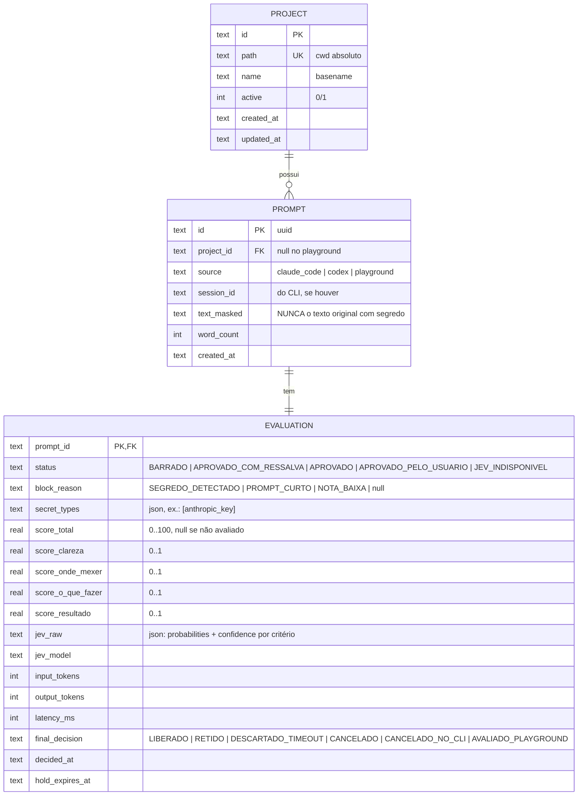

# Modelo de dados (proposta — consolidada na Fase 5)

## Regras
- `text_masked` é gravado **após** mascaramento (I3). Não existe coluna com o texto original.
- Coluna esquerda da UI = todos os `PROMPT` do projeto; coluna direita = `final_decision = LIBERADO`.
- Datas em ISO-8601 UTC.
- Migrations com Drizzle Kit; destrutivas são gate humano.
