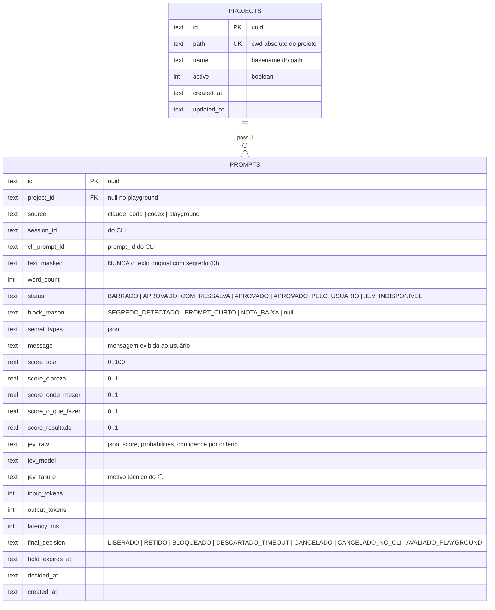

# Modelo de dados (consolidado na Fase 5)

Fonte executável: `apps/server/src/infra/db/schema.ts` · migrations em `apps/server/drizzle/` (aplicadas na inicialização).

## Regras
- **Uma tabela `prompts`** guarda o prompt e sua avaliação (relação 1:1; D51).
- `text_masked` é gravado **após** o mascaramento (I3). Não existe coluna com o texto original.
- Coluna esquerda da UI = todos os prompts do projeto; coluna direita = `final_decision = LIBERADO`.
- Índice `(project_id, created_at)` para as listas paginadas.
- Prompts `RETIDO` sem retenção ativa na memória (servidor reiniciado) viram `DESCARTADO_TIMEOUT` na inicialização.
- Datas ISO-8601 UTC. Migrations via `pnpm --filter @guardian/server db:generate`; destrutivas são gate G4.
