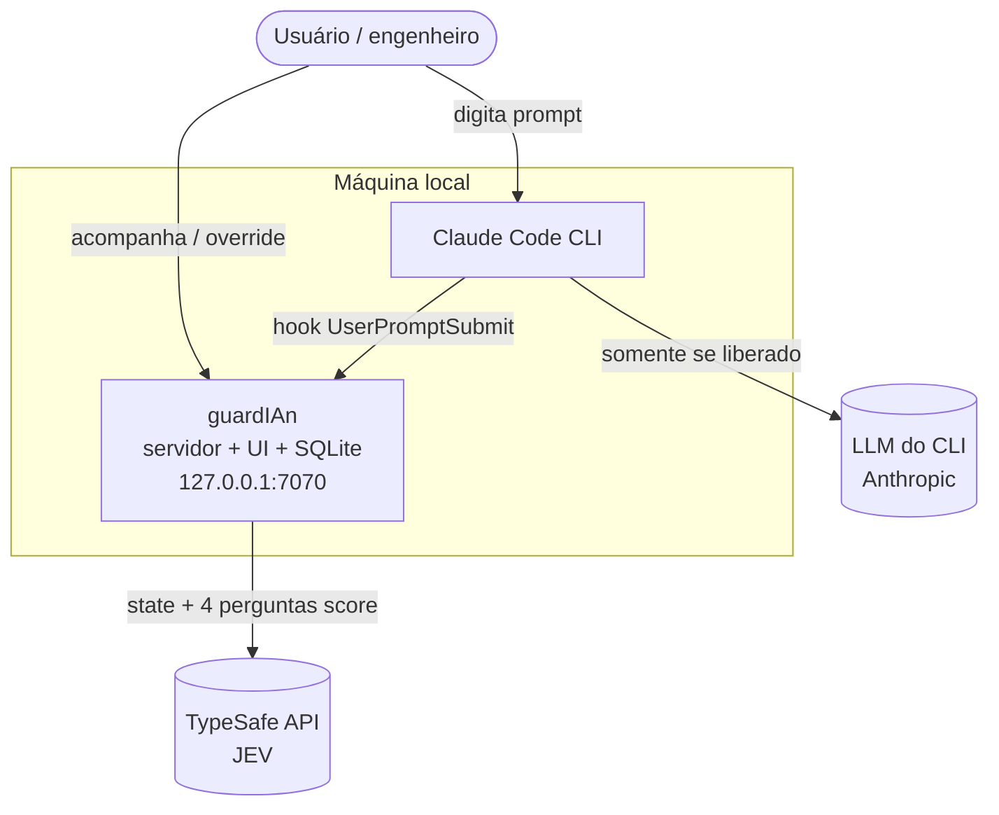

# Visão geral do sistema

## C4 — Contexto


## C4 — Containers
```mermaid
flowchart LR
  subgraph plugin[plugins/claude-code]
    HK[hook.mjs<br/>UserPromptSubmit]
    CMD[comandos /guardian-*]
  end
  subgraph server[apps/server - Fastify]
    API[API HTTP]
    PIPE[Pipeline de avaliação]
    RET[Gerenciador de retenção 60s]
    SSE[SSE /api/events]
    AV[Porta Avaliador<br/>JEV | Fake]
    REPO[Repositórios Drizzle]
  end
  WEB[apps/web - React<br/>servida pelo Fastify]
  DB[(SQLite<br/>data/guardian.db)]
  SH[[packages/shared<br/>tipos + constantes]]
  HK -- HTTP loopback --> API
  CMD -- HTTP loopback --> API
  API --> PIPE --> AV
  PIPE --> RET
  PIPE --> REPO --> DB
  PIPE --> SSE --> WEB
  WEB -- override / playground --> API
  SH -.-> server & WEB & plugin
```

## Implantação
Um único processo Node em `127.0.0.1:7070` serve API, SSE e a UI compilada. O plugin é instalado no Claude Code a partir deste repositório (marketplace). Sem Docker e sem nuvem no MVP.
