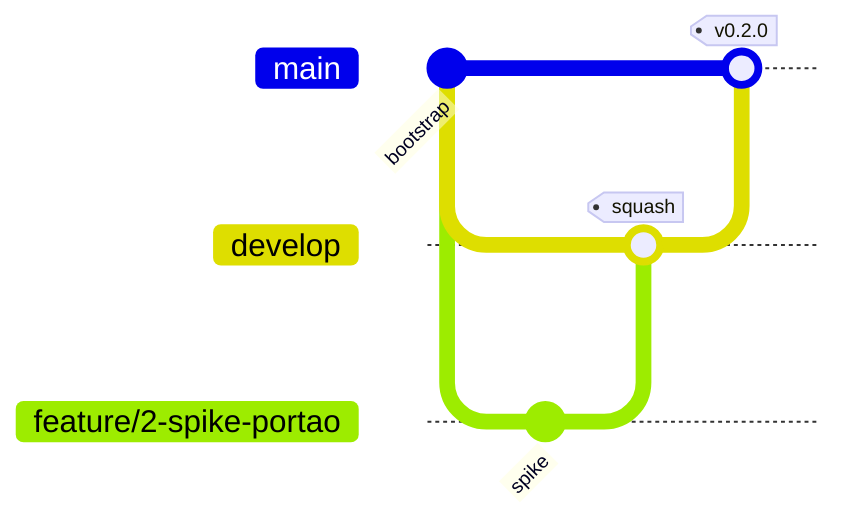

# GitFlow

Procedimento operacional: `.ai/skills/git-flow/SKILL.md` e `.ai/skills/commit/SKILL.md`.

| Item | Decisão |
|---|---|
| Remoto | GitHub `git@github.com:daniilooo/guardIAn.git` |
| Branches | `main`, `develop`, `feature/*`, `fix/*`, `hotfix/*` |
| Commits | Conventional Commits em PT-BR |
| Merge feature → develop | squash |
| Merge develop → main | merge commit + tag — **main só aceita PR vindo de `develop`** |
| Hotfix | sai de `main`, PR para `develop`, depois `develop → main` |
| Versionamento | SemVer; fase concluída → `v0.<fase>.0` (sugestão); MVP → `v1.0.0` |
| Revisão | Engenheiro revisa sozinho; Reviewer (IA) faz pré-revisão |
| Proteção (ativa) | rulesets no GitHub: sem push direto/force push/exclusão em `main` e `develop`; PR + CI obrigatórios ([[CI_CD]]) |

## Permissões da LLM
| Ação | Permissão |
|---|---|
| Criar branch / commitar na própria branch | ✅ |
| Push / abrir PR | ⚠️ autorização explícita |
| Merge / tag / release | ❌ humano |
