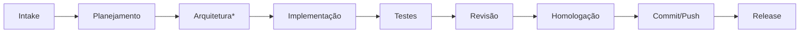

# Workflows

O workflow operacional da IA vive em **`.ai/workflow/`** (fonte única — não duplicar aqui).

| Fluxo | Arquivo |
|---|---|
| Triagem e fluxo proporcional | `.ai/workflow/START.md` |
| Intake | `.ai/workflow/INTAKE.md` |
| Planejamento → Commit | `.ai/workflow/*.md` |
| Gates humanos | [[HUMAN_GATES]] |

*Somente quando estrutural.
