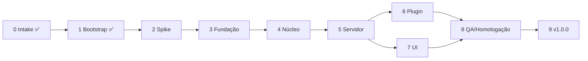

# Plano de desenvolvimento — guardIAn MVP

> Toda fase tem início e fim claros. Melhoria não essencial → [[POST_MVP_BACKLOG]]. Visão HTML: `docs/development-plan.html` (atualizar junto).

| Fase | Nome | Status | Versão |
|---|---|---|---|
| 0 | Intake | ✅ Concluído | — |
| 1 | Bootstrap AI-Native | ✅ Concluído | — |
| 2 | Spike do portão | ✅ Concluído | v0.2.0 |
| 3 | Fundação técnica | ✅ Concluído | v0.3.0 |
| 4 | Núcleo de avaliação | ✅ Concluído | v0.4.0 |
| 5 | Servidor e persistência | ✅ Concluído | v0.5.0 |
| 6 | Plugin Claude Code | ✅ Concluído | v0.6.0 |
| 7 | UI | ✅ Concluído | v0.7.0 |
| 8 | QA e Homologação | ⬜ Não iniciado | v0.8.0 |
| 9 | MVP Release | ⬜ Não iniciado | **v1.0.0** |

Fases 6 e 7 podem correr em paralelo depois da 5 (contrato da API definido).

---

## FASE 0 — Intake ✅
- **Objetivo:** transformar a ideia em definição de MVP.
- **Entregáveis:** respostas dos 6 blocos, regras R1–R17, Definition of MVP Done.
- **DoD:** resumo aprovado pelo engenheiro (2026-10-12). ✔

## FASE 1 — Bootstrap AI-Native ✅
- **Objetivo:** base de desenvolvimento multi-LLM rastreável.
- **Entregáveis:** vault, `.ai/`, adapters Claude/Codex/local, agentes, contratos, skills, especificação de hooks, GitFlow, roadmap, HTMLs, manual, README, git local (`main` + `develop`).
- **DoD:** estrutura criada e commitada localmente; nenhum código de produto. ✔

## FASE 2 — Spike do portão ✅
- **Objetivo:** provar, no Claude Code real, que o mecanismo de interceptação suporta R1, R5, R14 e R17 **antes** de construir o resto.
- **Escopo:** script descartável em `scripts/spike/` (hook Node mínimo + servidor HTTP mínimo, sem JEV, sem DB) e plugin local mínimo.
- **Fora do escopo:** JEV, UI, persistência, qualidade de código de produção.
- **Entregáveis:**
  - [x] Hook bloqueia prompt e exibe motivo no terminal
  - [x] Hook segura o prompt por 60s (timeout do hook = 75s) e libera por sinal externo (`curl`)
  - [x] Expiração de 60s descarta o prompt
  - [x] Verificado se `/guardian-*` (comando de plugin) dispara `UserPromptSubmit` e com qual texto
  - [x] Verificado o nome final dos comandos (namespacing do plugin)
  - [x] Verificado comportamento com servidor offline (fail-open)
  - [x] Descoberto: hook que estoura o timeout do CLI deixa o prompt passar → I11
  - [x] Validação manual interativa: espera de 60s OK; Esc descarta o prompt, mas o servidor não percebe → I12
  - [x] Chamadas reais ao JEV (G10): latência 272–569 ms; rubrica acerta 3/3 em PT e EN
  - [x] Conclusões registradas em [[CLAUDE_CODE_HOOKS]], [[TYPESAFE_JEV]] e ADR-0005 atualizado
  - [x] Decisão do engenheiro: `/guardian-*` executados pelo hook (D42)
- **Dependências:** Fase 1; chave TypeSafe no `.env` (para o item de JEV).
- **Critérios de aceite:** todos os itens acima com evidência (log/print).
- **DoD:** ADR-0005 confirmado ou regras R5/R14 revisadas com o engenheiro (G2).
- **Riscos:** hook não suportar espera longa → plano B: bloquear na hora + reenvio (opção "b" do intake).

## FASE 3 — Fundação técnica ✅
- **Objetivo:** monorepo executável com qualidade automatizada.
- **Escopo:** `pnpm-workspace.yaml`, `package.json` raiz, tsconfig base, ESLint, Prettier, Vitest, `packages/shared` (tipos, enums, constantes de negócio), lefthook, detector de segredos do pre-commit, GitHub Actions.
- **Entregáveis:**
  - [x] `pnpm install && pnpm lint && pnpm typecheck && pnpm test && pnpm build` verdes (46 testes)
  - [x] `packages/shared` com status, motivos, constantes (5, 50, 75, 60, 68, 75), marcadores, contratos HTTP e padrões de segredo
  - [x] lefthook instalado (pre-commit, commit-msg, pre-push) — bloqueio de mensagem inválida e de segredo comprovados
  - [x] Esteira de CI e rulesets de `main`/`develop` (antecipado — D39/D40)
  - [x] Job `qualidade` executando de fato — confirmado no log do CI dos PRs #5 e #6 (46 testes)
- **Dependências:** Fase 2 (contratos ajustados pelo spike).
- **DoD:** pipeline local e CI verdes; hooks bloqueiam commit com `.env` ou segredo.
- **Riscos:** `better-sqlite3` exigir toolchain nativa.

## FASE 4 — Núcleo de avaliação ✅
- **Objetivo:** domínio puro de decisão + adapter JEV.
- **Escopo:** isenção `/guardian-*`, contagem de palavras, detecção e mascaramento de segredos, composição de nota e faixas, porta `Avaliador` com `AvaliadorJev` e `AvaliadorFake`, timeout/erros → indisponível.
- **Entregáveis:**
  - [x] Funções de domínio com os casos de limite testados (comandos nas 2 formas, 4×5 palavras, 49,999/50/74,999/75, ordem I4) — teste de mutação confirma que pegam regressões
  - [x] Padrões de segredo com testes positivos/negativos (fixtures sintéticas) + mascaramento com sobreposição
  - [x] `AvaliadorJev` com as 4 perguntas Score da [[JEV_RUBRIC]] (HTTP direto, D48) e `AvaliadorFake`
  - [x] Rubrica calibrada com os 3 exemplos-alvo (spike, mesmo texto da rubrica de produção)
  - [x] Smoke do adaptador de produção contra o JEV real: 🔴 39,3% · 🟡 61,6% · 🟢 94,8% (306–514 ms)
- **DoD:** testes verdes sem rede; calibração registrada.
- **Riscos:** rubrica mal calibrada; latência do JEV.

## FASE 5 — Servidor e persistência ✅
- **Objetivo:** API local completa.
- **Escopo:** Fastify em `127.0.0.1`, config, SQLite + Drizzle + migrations, rotas de [[API_CONTRACTS]], retenção 60s com long-poll, override/cancelar, SSE, health do JEV.
- **Entregáveis:**
  - [x] Todas as rotas com testes de integração (`inject`, SQLite em memória, fake) — 23 testes
  - [x] Retenção: expiração, override, cancelamento, override expirado (409), override em segredo (403), queda da conexão do hook → `CANCELADO_NO_CLI` (I12, com teste de mutação)
  - [x] Nada não mascarado em DB/log/SSE (teste)
  - [x] Ponta a ponta com o processo real (`pnpm start`) via curl
  - [x] Contrato congelado em [[API_CONTRACTS]] e [[DATA_MODEL]]
- **DoD:** contrato da API congelado para Fases 6 e 7.

## FASE 6 — Plugin Claude Code ✅
- **Objetivo:** interceptação real, instalável.
- **Escopo:** `plugins/claude-code` (manifest, hooks.json com timeout 75s, `hook.mjs` sem dependências, comandos `/guardian-active` / `/guardian-inactive`), `marketplace.json` na raiz, mensagens de terminal.
- **Entregáveis:**
  - [x] Plugin e marketplace aprovados por `claude plugin validate`; instalação: `/plugin install guardian --marketplace daniilooo/guardIAn`
  - [x] allow / block / hold / fail-open testados executando o `hook.mjs` real contra o servidor (12 testes)
  - [x] Relógio interno do hook barra antes do timeout do CLI (I11) e o servidor registra `CANCELADO_NO_CLI`
  - [x] Comandos reconhecidos nas formas `/guardian-x` e `/guardian:guardian-x` (D42)
  - [x] Ativar/desativar projeto funcionando
  - [x] Claude Code real (`--plugin-dir`): ativar, retenção + override via curl, ⚪ sem JEV e segredo
- **Dependências:** Fase 5.
- **DoD:** fluxo J2/J3/J4 funciona no Claude Code real (sem UI, override via `curl`).

## FASE 7 — UI ✅
- **Objetivo:** observabilidade e override.
- **Escopo:** abas de projetos + Playground, colunas Todos × Liberados, cards com marcador e 4 barras, modal de override com aviso, banner JEV indisponível, SSE com reconexão, servida pelo Fastify.
- **Entregáveis:**
  - [x] Todos os marcadores com cor + ícone + texto (paleta de status reservada)
  - [x] Override/cancelar dentro da janela de 60s (contador visível; botão some ao expirar)
  - [x] Playground nunca libera
  - [x] 4 barras por critério com marca do limiar de 50% e tooltip
  - [x] Tempo real via SSE com reconexão; banner de JEV indisponível
  - [x] UI servida pelo próprio servidor (`pnpm start`), modo claro/escuro e mobile verificados por screenshot
  - [x] Jornadas J1–J6 navegáveis
- **Dependências:** Fase 5 (pode correr em paralelo à 6).
- **DoD:** jornadas J1–J6 navegáveis.

## FASE 8 — QA e Homologação
- **Objetivo:** validar o MVP contra a Definition of MVP Done.
- **Escopo:** QA paralelo (regras, API, hook, UI, segurança), security-review, execução do [[HOMOLOGATION_SCRIPT]] pelo engenheiro, ajuste fino da rubrica.
- **DoD:** roteiro 15/15 aprovado; nenhum achado crítico aberto.

## FASE 9 — MVP Release
- **Objetivo:** publicar `v1.0.0`.
- **Entregáveis:** CHANGELOG, README final, tag `v1.0.0` em `main` (humano), status atualizado.
- **DoD:** Definition of MVP Done 100% marcada.
